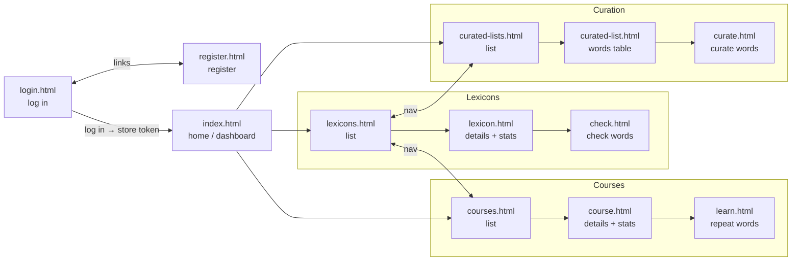
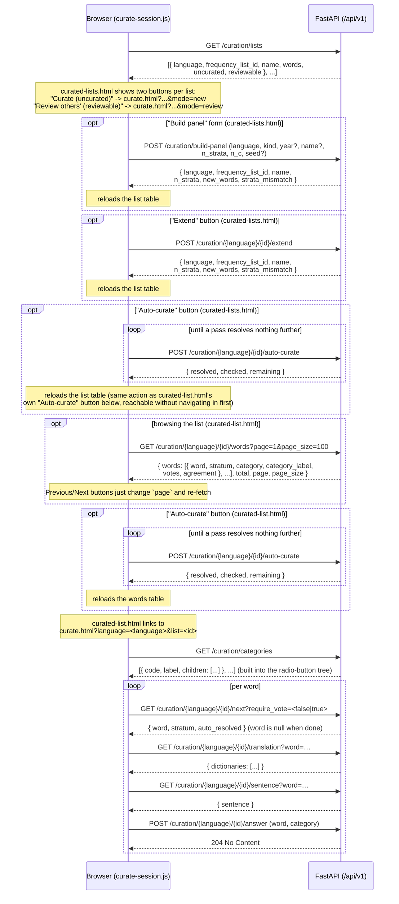

# Emmio web interface

A minimal web client for the Emmio API: **semantic HTML + a little vanilla
JavaScript**, no framework, no build step, and (for now) no CSS — the markup is
plain so the design can be decided later.

It talks to the FastAPI JSON API (`emmio/api/app.py`) over `fetch`, holding the
access token in `localStorage`. The API serves these files itself (mounted at
`/app`), so the page and the API share an origin and there is no CORS to set up.

## Running

```shell
uvicorn emmio.api.app:app --reload
```

Then open <http://localhost:8000/app/>. (Set `EMMIO_JWT_SECRET` and
`DATABASE_URL` as needed; see the API module.)

## Files

| File            | Role                                                         |
|-----------------|--------------------------------------------------------------|
| `index.html`    | Home / dashboard: a Languages section (rate, level, self-reported level, main lexicon) and a Courses section, each with its own "add" button. |
| `login.html`    | Log in form.                                                 |
| `register.html` | Registration form.                                           |
| `lexicons.html` | Table of the user's lexicons (short info per lexicon).       |
| `lexicon.html`  | One lexicon: details and statistics (rate, precision, …); "Words checked"/"Known"/"Don't know" link to `lexicon-words.html`. |
| `lexicon-words.html` | A lexicon's words, filtered All / Know / Don't know, paginated. |
| `check.html`    | Check a lexicon: shows a word, records know / don't know.    |
| `courses.html`  | Table of the user's learning courses.                        |
| `course.html`   | One course: details and statistics (due, learning, …).       |
| `learn.html`    | Learn a course: type the word (due repetitions and new ones).|
| `curated-lists.html` | Table of curated lists (word count, curate/auto-curate/extend/delete actions), plus a "build a panel" form (`emmio data build-panel`'s web equivalent). |
| `curated-list.html`  | One curated list: a paginated table of its words and their curation status. |
| `curate.html`   | Curate a list: shows a word, records its category.           |
| `new-language.html` | Add a language: opens an (initially empty) language object. |
| `app.js`        | Entry point: dispatches on `<body data-page="...">`.         |

`app.js` is loaded as an ES module (`<script type="module">`) and only holds
the dispatch table plus the release gate; the actual logic lives under `js/`,
one module per concern:

| Module                  | Role                                                            |
|--------------------------|------------------------------------------------------------------|
| `js/api.js`              | Token storage, the `fetch` helper, `requireAuth`.                |
| `js/format.js`           | Formatting/DOM helpers shared by every page (rate, dates, `<select>` fill, …). |
| `js/charts.js`           | The inline-SVG charts: rate trajectory, language history, stratum line. |
| `js/forms.js`            | Shared "create a lexicon / course / learning" form wiring.       |
| `js/check-session.js`    | `runSession()` (lexicon checking) and the check page.             |
| `js/learn-session.js`    | `runLearnSession()` (course learning) and the learn page.         |
| `js/curate-session.js`   | The curated-lists picker (plus its "build a panel" form, `emmio data build-panel`'s web equivalent), the per-list word table, and the curate page (`emmio curate`'s web equivalent). |
| `js/auth-pages.js`       | Landing, login, register.                                        |
| `js/home-pages.js`       | Dashboard, the per-language page, and add-a-language.             |
| `js/lexicon-pages.js`    | Lexicon list, lexicon detail + settings, add-a-lexicon.           |
| `js/lexicon-words.js`    | A lexicon's word list, filtered All / Know / Don't know.          |
| `js/course-pages.js`     | Course list, course detail + learning settings, add-a-course/learning. |
| `js/profile.js`          | Profile page.                                                    |
| `js/language-knowledge.js` | One language's self-reported estimates: add/list/delete, embedded in `language.html` by `initLanguage`. |

Lexicon checking uses `runSession()` (a yes/no flow: next → reveal translation
→ answer). Learning uses `runLearnSession()`, which renders whichever review
question type the server's `/question` endpoint chose:

- **type the word** — meaning (word blanked) + a translated example shown; type
  the word, auto-accepted on match against the server's `accepted`.
- **know** — see the word, self-assess Know / Don't-know, then the meaning shows.
- **choice** — pick the translation among options.
- **connect** — match several words to their translations at once.

New words still come from `/new` (taught as type-the-word, after the optional
`ask_lexicon` check). Each answered word is recorded via `/answer` with its
question type.

## Page flow



## Release vs development

Emmio's parts sit at very different stages, so a deployment can show only the
settled ones. Everything a release deployment does not show carries
`data-experimental` in the markup: the "Courses" and "Curated lists" nav
entries, the Courses sections on the dashboard and on a language's page (both
`id="courses"`), and the whole `<body>` of the pages behind them (`courses`,
`course`, `new-course`, `learning`, `new-learning`, `learn`,
`curated-lists`, `curated-list`, `curate`) — the sub-pages included, so a
bookmark cannot walk past a hidden door.

Those parts **start hidden**, by a `base.css` rule keyed off
`data-experimental`. `js/config.js` reads `GET /api/v1/config` once per page
load, and `app.js` puts the answer on `<html data-release="true|false">`;
only `"false"` (the server's `EMMIO_RELEASE` unset, see `RELEASE` in
`emmio/api/app.py`) lifts the rule. The same answer keeps a release
deployment from *fetching* what it will not show: `/me/courses` is not
requested at all on the dashboard or a language's page. Hiding first and revealing later, rather than the reverse,
means a slow `/config` shows nothing instead of showing everything and taking
it back. The rest of the page does not wait for the answer; only an
experimental page does, since on a release deployment it just redirects to
the dashboard.

This is presentation only: the API is untouched, and every one of those
endpoints still answers normally. Treat it as "what this deployment shows",
never as access control. A `/config` that errors is read as *not* release, so
a backend hiccup degrades to the development view rather than to a
half-navigable one.

## Authentication

The token is obtained once at login and attached to every later request:

- `POST /api/v1/auth/login` returns `{ access_token }`, stored under
  `localStorage["emmio_token"]`.
- The `api()` helper adds `Authorization: Bearer <token>` to each request.
- A `401` (missing or expired token) clears the token and returns to
  `login.html`.

## Request flow (a checking session)

The session page keeps a small client-side **queue** of upcoming words (each
with its translation already loading) and a **history** stack, so answering and
revealing a translation are instant, and any number of answers can be undone.

```mermaid
sequenceDiagram
    participant B as Browser (app.js)
    participant A as FastAPI (/api/v1)
    participant P as PostgreSQL

    B->>A: POST /auth/login (email, password)
    A-->>B: { access_token }  (stored in localStorage)

    Note over B: prefetch a queue of words
    B->>A: GET /me/lexicons/{id}/next?count=3
    A-->>B: { words: [...] }
    B->>A: GET /me/lexicons/{id}/translation?word=…  (per queued word)
    A-->>B: { dictionaries: [...] }

    loop per answer
        Note over B: show queued word instantly
        B->>A: POST /me/lexicons/{id}/answer (word, response)
        A-->>B: 204 No Content
        Note over B: push to history; pop next from queue
        B->>A: GET /next?count=1&exclude=<queued>  (top up, in background)
        A-->>B: { words: [...] }
    end

    opt undo (repeatable)
        B->>A: POST /me/lexicons/{id}/undo
        A->>P: delete latest record, rebuild word cache
        A-->>B: { word }  (re-presented to re-answer)
    end
```

`exclude` lists words already queued so a batch never repeats one. Learning runs
the analogous flow against `/me/courses/{id}` (its `/next` returns the
soonest-due questions); when those run out it pulls new words from `/new`, which
may first ask a know/don't-know check recorded in the course's `ask_lexicon`
before the word is taught. The `response` value depends on the resource:

> **Lexicon `/next` records as it samples.** It draws frequency-weighted words
> and, for every word it does *not* present (already known, flagged "skip",
> "not a word", foreign-alphabet, or answered recently), writes an automatic
> record — `propagate_skip`, `propagate_time`, `propagate_not_a_word`, or
> `assume_not_a_word` — instead of excluding it. This keeps the record stream a
> faithful frequency-weighted sample, which is what the vocabulary rate is
> computed from. A high-rate lexicon therefore writes many such records per
> request and may return fewer than `count` words (the client just tops up).


- Lexicon `/answer`: a `LexiconResponse` — `know`, `know_semantic_class`,
  `dont`, or `not_a_word` (plus a "Know and skip" that sets the skip flag).
  `dont_but_proper_noun_too` is legacy-only, no longer sent by the check
  page. A `not_a_word` answer may carry an extra `category` field — one of
  `NOT_TO_CHECK_CATEGORY_CODES` (`emmio/lexicon/core.py`), e.g. `P` for a
  proper noun — reporting *why*; the server writes that straight into the
  shared curated panel (`curated_words`/`curated_word_records`) as a real
  curation vote, the same one `emmio curate` would record, rather than a
  separate mechanism (see `_record_not_to_check_vote`).
- Course `/answer`: a `Response` — `y` (right), `n` (wrong), `s` (skip).

## Curation

`curate.html`/`curate-session.js` is the web equivalent of `emmio curate`: instead of a
know/don't-know question, the curator picks which category a word belongs to. `GET
/curation/categories` returns the taxonomy as a tree — group (1) alone, group (2) nested
under a non-selectable "Not to check" heading (mirroring `NOT_TO_CHECK_TREE`'s own
nesting, e.g. "Missing spaces"/"Missing diacritics" under "Misspelling"), then "Unsure" —
which the client renders as a hierarchical `<ul>` of radio buttons sharing `name=
"category"`, so the client never hardcodes the taxonomy and never has to flatten it by
hand either. A node with children (e.g. "Misspelling") is still independently selectable
alongside its own subcategories; selecting any radio fires `change`, answering
immediately with no separate submit step. A list is addressed by `(language,
frequency_list_id)` everywhere — the same pair `emmio curate <language>
<frequency_list_id>` takes, and the schema's own `UNIQUE (language, frequency_list_id)`
key — never by the database-internal numeric `curated_lists.id`. Simpler than a checking
session — no prefetch queue, since `GET /curation/{language}/{id}/next` is a cheap query
(not an expensive selector draw worth amortizing), and no undo (a curation vote is real
history from the moment it lands):



`POST /curation/build-panel` is the web equivalent of `emmio data build-panel`: it draws
`n_c` words per log-uniform stratum from a frequency list into a new (or existing) curated
panel — `frequency_words` downloads its source on demand if not already cached,
`opensubtitles` (Emmio-generated, no catalog) requires the file to already exist locally.
`n_c` is a per-stratum target, not a per-call draw count, so calling it again with the same
target is a no-op and a larger one tops every stratum up rather than redrawing it; an
existing list's own `n_strata` always wins over the request's (`strata_mismatch` tells the
client so, for a status message) so stratum boundaries stay consistent with words already
curated. See `emmio.lexicon.curation.build_or_extend_curated_panel`, shared with the CLI.

`POST /curation/{language}/{id}/extend` is the "Extend" button next to each list on
`curated-lists.html`: rather than a target the caller picks, it always draws 50 further
words into *every* stratum, regardless of how many it already has — a small head
stratum's population may already be exhausted below the original target while
learner-driven fallback promotion pushes another stratum ahead of it, so a single new
absolute target (`build-panel`'s `n_c`) could silently do nothing for some strata. A
stratum with nothing left to draw is simply skipped (its population, not the +50, caps
it), the same as `build-panel`. See `emmio.lexicon.curation.extend_curated_panel`.

`/next` skips words an automatic check already resolves (outside the alphabet, `cap_ratio`
past the proper-noun threshold, or clear dictionary evidence either way) without writing
anything — `auto_resolved` in the response is purely informational (e.g. for a "skipped N
words" status line), not something the client acts on. See
`emmio.lexicon.curation.classify_automatically`, shared with the CLI's `emmio curate`.
`require_vote` (from `curate.html`'s `?mode=new|review` query param, set by which of the
picker's two buttons was clicked) narrows the candidate pool: `false` to words nobody has
voted on at all, `true` to words that already have a *human* vote (not this curator's) —
Emmio's auto-curation does not count, so a word it alone has voted on still surfaces under
`false` instead, letting a curator add a second opinion on top of an existing human's
rather than being asked to double-check the bot's high-confidence dictionary calls.
Omitted, it is unrestricted, same as before this parameter existed. See
`postgres.get_next_curation_candidate`, `postgres.count_reviewable_words`.

`/words` is a read-only overview, ordered the same way the panel is served (`stratum`,
then `panel_order` within it) so paging through it is a stable, meaningful reading order,
not just insertion order. `page`/`page_size` are clamped rather than rejected (`page < 1`
becomes `1`; `page_size` is capped), matching `/me/lexicons/{id}/next`'s `count` handling.
`category`/`category_label`/`votes`/`agreement` are exactly what `curated_words` caches —
nothing here is computed on the fly.

`/auto-curate` runs `classify_automatically` (the same evidence `/next` uses to silently
*skip* a word) over words the synthetic `"emmio"` curator has not yet voted on, and
records real votes for whatever it can resolve — the difference from `/next` is that this
writes, rather than recomputing the same judgment fresh every time. That curator is
created lazily, with no password, so nothing can log in as it; a human voting on the same
word later is just another `curator_id`, and the normal "mode of each curator's latest
vote" consensus lets them override the bot with no special-casing. Each call is one
budget-capped pass (`_AUTO_CURATE_BUDGET`), so `curate-session.js` loops client-side,
calling again until a pass resolves nothing further — `remaining` does not have to reach
0, since a word with no automatic evidence either way is correctly left for a human
forever.

## Scope and limitations

- **Learning teaches new words too.** The learning page repeats *due* words and,
  when none remain, adds new ones drawn from the course's frequency lists
  (`/new`), honoring its `check_lexicons` / `ask_lexicon`. Typing is graded
  against the card's `accepted` forms (today the exact word). Audio
  pronunciation is the one `Teacher` feature not yet exposed.
- **Create from the home page.** A freshly registered user has no lexicons or
  courses; the home page offers "Add a lexicon" (`POST /me/lexicons`) and "Add a
  course" (`POST /me/courses`) to make the first ones. Both draw on the shared
  frequency lists, dictionaries and Tatoeba sentences for the chosen language.
- **Each `next` reloads server-side state.** A `/next` request reloads the
  lexicon/course from the database to pick words; the client buffer hides this
  latency, but a persistent server-side session would still be more efficient.
