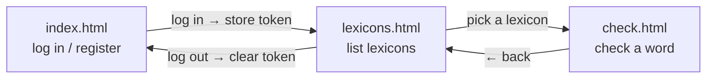
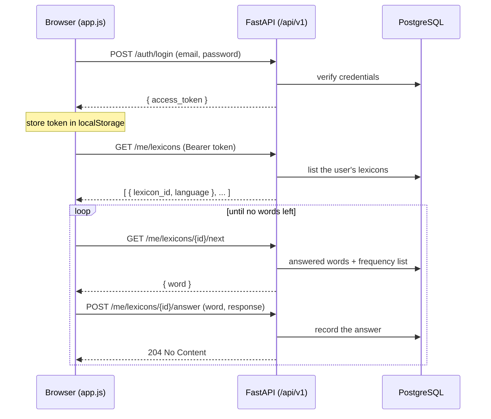

# Emmio web interface

A minimal web client for the Emmio API: **semantic HTML + a little vanilla
JavaScript**, no framework, no build step, and (for now) no CSS — the markup is
plain so the design can be decided later.

It talks to the FastAPI JSON API (`emmio/api/app.py`) over `fetch`, holding the
access token in `localStorage`. The API serves these files itself (mounted at
`/app`), so the page and the API share an origin and there is no CORS to set up.

## Running

```sh
uvicorn emmio.api.app:app --reload
```

Then open <http://localhost:8000/app/>. (Set `EMMIO_JWT_SECRET` and
`DATABASE_URL` as needed; see the API module.)

## Files

| File            | Role                                                        |
|-----------------|-------------------------------------------------------------|
| `index.html`    | Log in and register forms.                                  |
| `lexicons.html` | Lists the signed-in user's lexicons.                        |
| `check.html`    | Checks one lexicon: shows a word, records know / don't know.|
| `app.js`        | Token storage, the `fetch` helper, and per-page logic.      |

`app.js` dispatches on `<body data-page="...">`, so each page is plain HTML that
just includes the one script.

## Page flow



## Authentication

The token is obtained once at login and attached to every later request:

- `POST /api/v1/auth/login` returns `{ access_token }`, stored under
  `localStorage["emmio_token"]`.
- The `api()` helper adds `Authorization: Bearer <token>` to each request.
- A `401` (missing or expired token) clears the token and returns to
  `index.html`.

## Request flow (a checking session)



The `response` sent to `/answer` is a `LexiconResponse` value: `know`, `dont`,
`dont_but_proper_noun_too`, or `not_a_word`.

## Scope and limitations

The interface only covers what the API exposes today: **authentication and
lexicon checking**.

- **Learning** (the spaced-repetition flow) is not on the API yet, so it is not
  in the web interface.
- A **freshly registered** user has no lexicons, and there is **no
  create-lexicon endpoint** yet — so the checking page is only usable by a user
  who already owns lexicons in the database. Creating lexicons over the API is a
  pending backend task.
