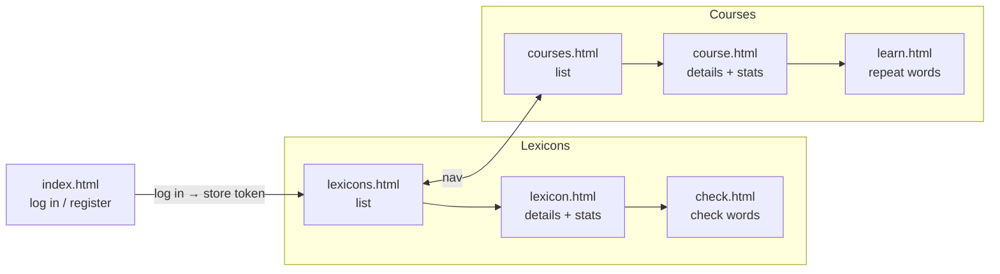
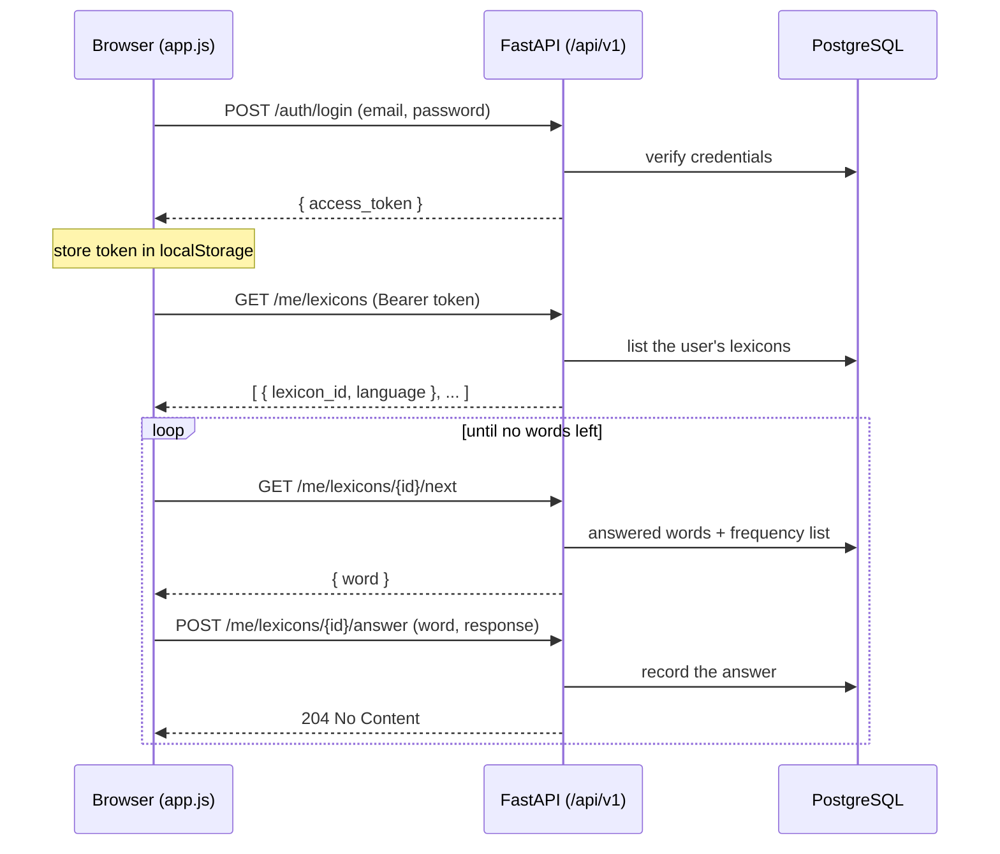

# Emmio web interface

A minimal web client for the Emmio API: **semantic HTML + a little vanilla
JavaScript**, no framework, no build step, and (for now) no CSS — the markup is
plain so the design can be decided later.

It talks to the FastAPI JSON API (`emmio/api/app.py`) over `fetch`, holding the
access token in `localStorage`. The API serves these files itself (mounted at
`/app`), so the page and the API share an origin and there is no CORS to set up.

## Running

```sh
uvicorn emmio.api.app:app --reload
```

Then open <http://localhost:8000/app/>. (Set `EMMIO_JWT_SECRET` and
`DATABASE_URL` as needed; see the API module.)

## Files

| File            | Role                                                         |
|-----------------|--------------------------------------------------------------|
| `index.html`    | Log in and register forms.                                   |
| `lexicons.html` | Table of the user's lexicons (short info per lexicon).       |
| `lexicon.html`  | One lexicon: details and statistics (rate, precision, …).    |
| `check.html`    | Check a lexicon: shows a word, records know / don't know.    |
| `courses.html`  | Table of the user's learning courses.                        |
| `course.html`   | One course: details and statistics (due, learning, …).       |
| `learn.html`    | Repeat a course: shows a due word, records right / wrong.    |
| `app.js`        | Token storage, the `fetch` helper, and per-page logic.       |

`app.js` dispatches on `<body data-page="...">`, so each page is plain HTML that
just includes the one script. The lexicon-checking and learning pages share one
`runSession()` flow (next → reveal translation → answer), differing only in the
resource path (`/me/lexicons/{id}` vs `/me/courses/{id}`).

## Page flow



## Authentication

The token is obtained once at login and attached to every later request:

- `POST /api/v1/auth/login` returns `{ access_token }`, stored under
  `localStorage["emmio_token"]`.
- The `api()` helper adds `Authorization: Bearer <token>` to each request.
- A `401` (missing or expired token) clears the token and returns to
  `index.html`.

## Request flow (a checking session)



The same loop drives learning, against `/me/courses/{id}` instead. The
`response` value depends on the resource:

- Lexicon `/answer`: a `LexiconResponse` — `know`, `dont`,
  `dont_but_proper_noun_too`, `not_a_word` (plus a "Know and skip" that sets the
  skip flag).
- Course `/answer`: a `Response` — `y` (right), `n` (wrong), `s` (skip).

## Scope and limitations

- **Learning is review-only.** The learning pages repeat words that are already
  being learned and are *due* (spaced repetition). Adding *new* words needs the
  interactive `Teacher` and is not exposed over the API yet, so a course with no
  due words shows "Nothing to repeat right now."
- **No create endpoints.** A freshly registered user has no lexicons or courses,
  and there is no API to create them yet — so the session pages are usable only
  by a user who already owns data in the database (e.g. a migrated CLI user).
- **Sessions reload on each `next`.** Each "next" reloads the lexicon/course from
  the database to pick the next word; fine for now, but stateful sessions are a
  future optimization.
